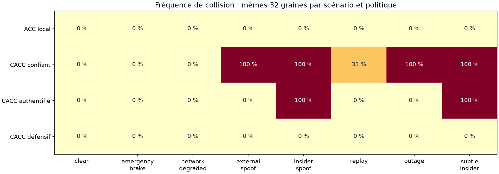
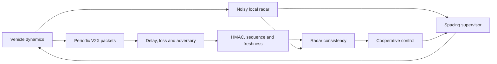

# Secure Convoy

[](https://github.com/thezanis11/secure-convoy/actions/workflows/checks.yml)

Repository: [thezanis11/secure-convoy](https://github.com/thezanis11/secure-convoy).

**Reproducible platoon control and V2X security experiments, with closed-loop SUMO cross-engine validation.**

Control systems · autonomous vehicles · networked systems · automotive security · Python

Secure Convoy studies seven vehicles following a leader while cooperative messages are delayed, dropped, replayed or falsified. It combines a longitudinal vehicle model, noisy radar, a causal communication queue, message authentication, sensor consistency checks and a physical spacing supervisor.

This is a control and security research project. Its main result comes from simulation and hypothesis testing, not a trained neural network or a claim of real-road safety.



## Actual work and deliverables

- **1,024 primary simulations:** eight scenarios × four policies × 32 paired seeds.
- **96 ablation runs:** remove authentication, radar consistency or the supervisor.
- **36 time-step trials:** compare 100/50/25 ms integration on matched cases.
- **32 closed-loop SUMO 1.28.0 comparisons**, retaining the same controller/actuator assumptions.
- Standalone interactive trajectory replay, raw trial CSVs, fixed protocol, source hashes, Wilson intervals and paired bootstrap comparisons.
- **14 tests**, including an opt-in SUMO integration test executed locally and in GitHub Actions.

Read the [standalone HTML report](reports/index.html), [measured summary](reports/RESULTS_FR.md), [control and threat model](docs/METHOD.md), and [French learning guide](docs/GUIDE_FR.md).

GitHub displays Markdown and figures. Download the repository ZIP and open `reports/index.html` locally to use the interactive replay. No server is required.

## Measured findings

For the prescribed 32 seeds in the insider-spoofing scenario, trusting and authenticated-only CACC each collided in 32/32 runs; the layered controller collided in 0/32. The local-radar ACC baseline also had no collisions across this grid. Authentication prevents external modification and replay but cannot establish that a compromised sender's signed state is true.

**0/32 is not proof of zero risk:** the Wilson 95% upper bound is approximately 10.7% for that cell. These intervals concern the model's stochastic trials, not real-world accident probability. The defense changes spacing and comfort; those costs are exported rather than hidden.

SUMO agreed on collision occurrence in 32/32 cross-engine comparisons, with near-roundoff position differences. This agreement is expected because the controllers, sensor samples and actuator model are shared and both engines use ballistic movement. It checks software coupling; it does not independently validate vehicle physics.

## Reproduce — Windows PowerShell

```powershell
python -m venv .venv
.\.venv\Scripts\python.exe -m pip install -r requirements-lock.txt
.\.venv\Scripts\python.exe -m unittest discover -s tests -v
.\.venv\Scripts\python.exe -m secure_convoy.cli benchmark --seeds 32
```

Install the optional SUMO backend and run its comparisons:

```powershell
.\.venv\Scripts\python.exe -m pip install -r requirements-sumo.txt
.\.venv\Scripts\python.exe -m secure_convoy.cli sumo-validate --seeds 2
$env:RUN_SUMO_TESTS='1'
.\.venv\Scripts\python.exe -m unittest discover -s tests -v
.\.venv\Scripts\python.exe scripts/refresh_report.py
```

On Linux/macOS use `.venv/bin/python`; use `RUN_SUMO_TESTS=1 .venv/bin/python -m unittest discover -s tests -v` for integration tests. Core simulation needs no network or vehicle hardware. TraCI uses a local socket. SUMO binaries and their optional data require several hundred MB. Runtime depends on hardware; interrupted experiment grids resume from recipe-specific checkpoints.

Run an individual case:

```powershell
.\.venv\Scripts\python.exe -m secure_convoy.cli simulate --scenario insider_spoof --controller defended_cacc --seed 1000 --out reports/custom_trace.csv
```

## Model overview



The same physical actuator limits and initial state apply to all policies. ACC uses a larger headway. The defended controller also opens gaps when necessary; compactness and comfort are part of the trade-off. The spacing RMSE uses a common 0.75 s compactness reference, not each policy's own desired-gap error.

## Important boundaries

- Public deterministic HMAC keys demonstrate protocol behavior; there is no production PKI, key exchange or secure hardware.
- A compromised sender can sign lies; a noisy or compromised local sensor can defeat assumptions made by the supervisor.
- Safety supervision is a heuristic inspired by headway barrier inequalities; actuator lag, discretization and measurement noise prevent a formal invariance claim.
- A run stops at the first physical contact. Collision-truncated comfort metrics have unequal observation horizons.
- There is no lateral motion, detailed tire friction, full radio/network stack or independently validated vehicle model.
- Acceleration-energy gain is a finite-horizon proxy, not an analytical string-stability proof.
- This project was developed with AI assistance; the learning guide identifies the decisions to understand and extend personally.

## Files and references

`secure_convoy/`: dynamics, messages, policies, experiments and SUMO adapter. `reports/`: measured outputs and replay. `tests/`: protocol, numerical and integration checks. Generated checkpoints and SUMO networks stay in ignored `data/`.

Code: [MIT](LICENSE). SUMO retains its upstream licenses. References: [SUMO](https://eclipse.dev/sumo/), [TraCI](https://sumo.dlr.de/docs/TraCI/), [Plexe](https://plexe.car2x.org/). This implementation is original project code, not a reproduction of a published Plexe controller.
